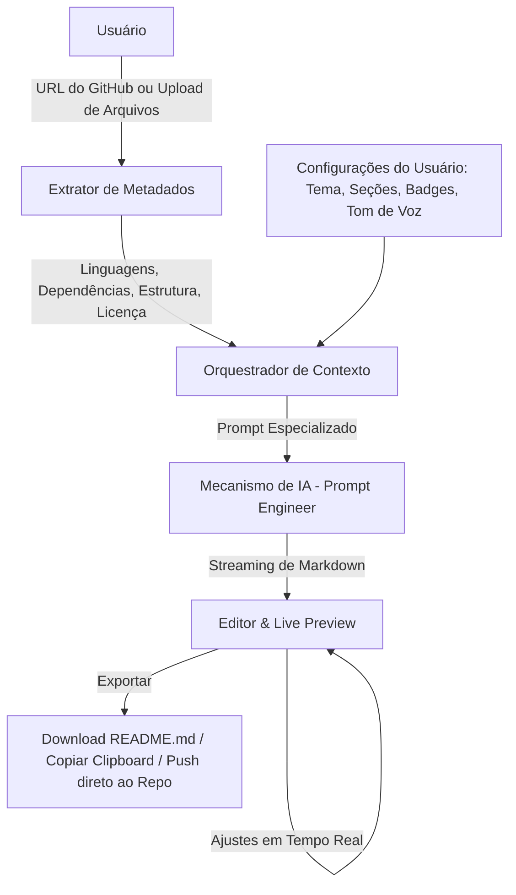

# Plano de Implementação: ReadmeCraft (Gerador de README para GitHub)
*Orquestração Multi-Agente no Claude Code*

## Visão Geral do Projeto
O objetivo é desenvolver uma aplicação completa de **Gerador de README para o GitHub** (denominada **ReadmeCraft**), capaz de analisar repositórios locais ou remotos (via GitHub API ou upload/colagem de código/estrutura) e utilizar Inteligência Artificial para gerar documentações elegantes, profissionais, estruturadas e visualmente impressionantes (com badges do Shields.io, diagramas Mermaid, stacks de tecnologias, guias de instalação, licenças e screenshots).

O projeto será implementado através do **Claude Code**, orquestrando os agentes especializados disponíveis no ambiente do usuário.

---

## Seleção de Agentes do Claude Code

Dentre os 11 agentes disponíveis, definimos o papel cirúrgico de cada um no ciclo de desenvolvimento:

| Agente | Papel no Projeto | Fase de Atuação |
| :--- | :--- | :--- |
| **`backend-architect`** | Desenho da arquitetura de integração (GitHub API, LLM providers, streaming de texto, rotas e cache). | Fase 1 e 2 |
| **`ui-ux-designer`** | Design system, experiência de live preview lado a lado, seletor de templates, badges e paleta moderna. | Fase 1 |
| **`prompt-engineer`** | Engenharia dos prompts de IA para extração de contexto de código e geração de READMEs de alto padrão. | Fase 2 |
| **`frontend-developer`** | Construção da interface reativa, preview Markdown em tempo real, editor com syntax highlight e exportador. | Fase 3 |
| **`typescript-pro`** | Tipagem estrita end-to-end, hooks customizados, validação de schemas (Zod) e integridade de tipos. | Fase 2 e 3 |
| **`python-pro`** *(Opcional)* | Caso seja adotado backend em Python (FastAPI); se o projeto for Fullstack TS, foca em scripts de automação. | Fase 2 |
| **`security-auditor`** | Prevenção contra XSS em Markdown (DOMPurify/Rehype), gestão de API Keys/tokens do GitHub e rate limiting. | Fase 4 |
| **`test-engineer`** | Testes unitários de parsing, testes de componentes frontend e mocks de chamadas de API. | Fase 4 |
| **`code-reviewer`** | Validação final de código, lint, padrões de design, performance e consistência da arquitetura. | Fase 5 |
| **`debugger`** | Acionado sob demanda para erros de compilação, problemas de hidratação ou falhas de requisição. | Todas as fases |
| **`database-architect`** | (Fase posterior / Opcional) Modelagem de persistência de histórico de READMEs e templates salvos. | Fase 6 |

---

## Arquitetura Tecnológica (Recomendada: Fullstack TypeScript)

- **Frontend**: React + Vite + TypeScript + Tailwind CSS + Lucide Icons + React-Markdown (com plugins GFM, Rehype-Highlight e Mermaid).
- **Backend / API**: Servidor Node.js leve (Fastify/Express/Hono) ou Next.js App Router, integrando com Anthropic/OpenAI/Gemini APIs e GitHub REST API.
- **Modos de Operação**:
  - **Repositórios Públicos**: Análise automática apenas informando a URL do GitHub.
  - **Projetos Locais / Manuais**: Análise da árvore de arquivos, `package.json`, `requirements.txt`, etc.

---

## Funcionalidades Principais



1. **Modos de Entrada**:
   - **URL do Repositório GitHub**: Busca automática via GitHub API pública (ou com PAT) do `tree` de arquivos, dependências (`package.json`, `requirements.txt`, `pom.xml`, etc.), releases e licença.
   - **Modo Manual / Local**: Upload de estrutura de pastas ou preenchimento guiado por etapas (Wizard).
2. **Seleção de Seções e Estilos**:
   - Badges automáticos (Shields.io: status, licença, versão, cobertura de testes).
   - Tech Stack em ícones (Badges estilizados ou Devicons).
   - Descrição e badges dinâmicos.
   - Arquitetura e Fluxograma (Mermaid diagramas gerados pela IA).
   - Pré-requisitos, Instalação e Execução local / Docker.
   - Variáveis de ambiente (`.env.example`).
   - Guia de Contribuição e Licença.
3. **Estilos Visuais (Templates)**:
   - *Minimalist*: Direto ao ponto, clean, foco em código.
   - *Showcase / Modern*: Badges coloridos, banners, cards, alta estética para portfólio.
   - *Enterprise*: Foco em governança, segurança, CI/CD, arquitetura robusta.
   - *Open Source*: Foco em roadmap, contribuições, issues e badges de comunidade.
4. **Editor Lado a Lado (Split-view)**:
   - Painel esquerdo: Editor Markdown com suporte a inserção rápida de componentes.
   - Painel direito: Renderização idêntica ao GitHub (GFM, tabelas, code blocks, alerts e diagramas Mermaid).
5. **Ações Rápidas**:
   - Copiar Markdown bruto.
   - Download de `README.md`.
   - Gerador de imagens/banners sugeridos.

---

## Roteiro de Execução Passo a Passo no Claude Code

### Etapa 1: Arquitetura e Design System
**Agentes**: `backend-architect`, `ui-ux-designer`
- **Ações**:
  1. Definir a estrutura de pastas do projeto (monorepo ou frontend/backend).
  2. Modelar as interfaces de dados (`RepoMetadata`, `ReadmeSection`, `ReadmeTemplate`, `GeneratorOptions`).
  3. Definir o design system: paleta de cores (modo escuro/claro com tema GitHub Dark/Modern Obsidian), tipografia (Inter / JetBrains Mono), layout da área de trabalho split-screen.
- **Comando no Claude Code**:
  ```text
  @ui-ux-designer @backend-architect Definam a arquitetura técnica e o design system para o ReadmeCraft com layout split-view, seletor de badges e templates.
  ```

---

### Etapa 2: Engenharia de Prompts e Extração de Metadados
**Agentes**: `prompt-engineer`, `typescript-pro` (ou `python-pro`)
- **Ações**:
  1. Implementar o serviço de extração de metadados do GitHub (`githubService`): busca de árvore de arquivos, leitura dos arquivos de manifesto (`package.json`, `Cargo.toml`, `go.mod`, etc.).
  2. Criar os templates de prompt especializados com system prompts rigorosos:
     - Instruções para nunca alucinar comandos que não existam nas dependências.
     - Formatação estrita compatível com GitHub Flavored Markdown (GFM).
     - Geração automática de diagramas Mermaid baseados na árvore de diretórios.
     - Seleção inteligente de badges do Shields.io de acordo com as stacks detectadas.
- **Comando no Claude Code**:
  ```text
  @prompt-engineer Crie os prompts de IA para análise de repositórios e geração de seções de README com badges do Shields.io, diagramas Mermaid e instruções precisas de instalação.
  ```

---

### Etapa 3: Desenvolvimento do Core e Interface
**Agentes**: `frontend-developer`, `typescript-pro`
- **Ações**:
  1. Configurar Vite + React + TypeScript + Tailwind CSS.
  2. Criar os componentes modulares:
     - `Header` com seletor de templates e status da API.
     - `RepoInputForm` (input de URL do GitHub + botão de análise rápida).
     - `SectionConfigurator` (toggles para ativar/desativar seções: Badges, Instalação, Arquitetura, etc.).
     - `MarkdownEditor` (editor com números de linha, atalhos de formatação).
     - `MarkdownPreview` (renderizador com `react-markdown`, `remark-gfm`, `rehype-raw`, `rehype-highlight` e renderizador de Mermaid).
     - `ExportToolbar` (botões Copiar, Download, regenerar seção específica).
  3. Integrar chamada de streaming de IA (ReadableStream) para que o README apareça em tempo real no preview.
- **Comando no Claude Code**:
  ```text
  @frontend-developer @typescript-pro Desenvolvam a interface do ReadmeCraft com layout split-screen, preview em tempo real com suporte a Mermaid/GFM e streaming de geração.
  ```

---

### Etapa 4: Segurança e Validação
**Agente**: `security-auditor`
- **Ações**:
  1. Higienização do Markdown: configurar `DOMPurify` ou sanitize-html no preview para evitar injeções XSS ao renderizar HTML personalizado.
  2. Proteção de credenciais: garantir que chaves de API (OpenAI/Anthropic/GitHub) nunca vazem no bundle do cliente (uso de proxies de backend ou armazenamento exclusivo no `localStorage` sob consentimento explícito).
  3. Validação de URLs e SSRF: proteger chamadas para a API do GitHub contra URLs maliciosas.
- **Comando no Claude Code**:
  ```text
  @security-auditor Audite o código do ReadmeCraft quanto a sanitização de Markdown (XSS), manipulação de tokens do GitHub e proteção contra abusos de API.
  ```

---

### Etapa 5: Testes e Confiabilidade
**Agente**: `test-engineer`
- **Ações**:
  1. Testes unitários para os parsers de metadados (`package.json`, `pom.xml`, `requirements.txt`).
  2. Testes de renderização dos componentes principais (`RepoInputForm`, `MarkdownPreview`).
  3. Testes com mocks de respostas de IA e da GitHub API usando Vitest / Testing Library.
- **Comando no Claude Code**:
  ```text
  @test-engineer Crie uma suíte de testes com Vitest cobrindo os parsers de repositório, validações de formulário e a renderização do preview Markdown.
  ```

---

### Etapa 6: Revisão de Código e Refatoração
**Agente**: `code-reviewer`
- **Ações**:
  1. Revisão completa da base de código contra boas práticas, Clean Code e padrões SOLID.
  2. Otimização de performance no preview (debounce de digitação, memoization de renderização pesada do Markdown/Mermaid).
  3. Checagem de acessibilidade (WCAG) e consistência visual.
- **Comando no Claude Code**:
  ```text
  @code-reviewer Revise toda a base de código do ReadmeCraft, focando em consistência de tipos, otimização de re-renderizações e conformidade com os requisitos.
  ```

---

## Estrutura de Arquivos Proposta

```text
ReadmeCraft/
├── PLANO_IMPLEMENTACAO.md
├── .env.example
├── README.md
├── package.json
├── tsconfig.json
├── vite.config.ts
├── src/
│   ├── assets/
│   ├── components/
│   │   ├── common/
│   │   │   ├── Button.tsx
│   │   │   ├── Card.tsx
│   │   │   └── Modal.tsx
│   │   ├── editor/
│   │   │   ├── MarkdownEditor.tsx
│   │   │   ├── Toolbar.tsx
│   │   │   └── SectionManager.tsx
│   │   ├── preview/
│   │   │   ├── MarkdownPreview.tsx
│   │   │   ├── MermaidDiagram.tsx
│   │   │   └── BadgeGallery.tsx
│   │   └── repository/
│   │       ├── RepoInput.tsx
│   │       └── TechStackDetector.tsx
│   ├── hooks/
│   │   ├── useGithubRepo.ts
│   │   ├── useReadmeGenerator.ts
│   │   └── useCopyToClipboard.ts
│   ├── services/
│   │   ├── githubService.ts
│   │   ├── aiService.ts
│   │   └── markdownSanitizer.ts
│   ├── prompts/
│   │   ├── systemPrompts.ts
│   │   ├── templatePrompts.ts
│   │   └── badgePrompts.ts
│   ├── types/
│   │   ├── github.ts
│   │   ├── template.ts
│   │   └── readme.ts
│   └── App.tsx
└── tests/
    ├── services/
    └── components/
```

---

## Plano de Verificação

### Testes Automatizados
- Executar suíte de testes unitários:
  ```bash
  npm run test
  ```
- Verificação de tipos TypeScript e Linting:
  ```bash
  npm run typecheck
  npm run lint
  ```

### Verificação Manual
1. **Fluxo com URL Real**: Inserir uma URL de repositório público e verificar se as linguagens e dependências são detectadas com precisão.
2. **Qualidade do README**: Verificar se o README gerado contém badges válidos no Shields.io, diagrama Mermaid sintaticamente correto e instruções reais de instalação.
3. **Editor em Tempo Real**: Editar o texto no painel esquerdo e garantir que o painel direito atualize instantaneamente sem falhas ou perda de cursor.
4. **Exportação**: Testar a cópia para a área de transferência e o download do arquivo `README.md`.
