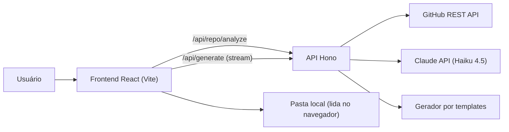

<div align="center">

# ReadmeCraft 🚀

**Gerador inteligente de README para o GitHub, projetado para transformar repositórios em apresentações visuais de alto impacto.**

[](https://github.com/lmaciel0/ReadmeCraft/actions/workflows/ci.yml)


</div>

## ✨ Funcionalidades

- **Análise de repositórios públicos** pela URL do GitHub: árvore de arquivos, linguagens, licença, release, tópicos e manifestos (`package.json`, `requirements.txt`, `pyproject.toml`, `pom.xml`, `build.gradle`, `Cargo.toml`, `go.mod`, `composer.json`, `Gemfile`) e nomes de variáveis do `.env.example`.
- **Modo local/manual**: abra uma pasta do seu computador (lida inteiramente no navegador) ou cole a saída do `tree` e o conteúdo dos manifestos.
- **Geração com Claude em streaming** — o README aparece no preview enquanto é escrito.
- **Modo offline por templates**: sem chave de API, um gerador determinístico monta o README só com dados verificados.
- **Anti-alucinação**: comandos de instalação/execução são derivados dos manifestos e enviados ao modelo como a *única* fonte permitida.
- **4 templates**: Minimalist, Showcase, Enterprise e Open Source.
- **17 seções configuráveis**, com **regeneração de seção individual** (marcadores `<!-- rc:section=... -->` invisíveis no GitHub).
- **Editor lado a lado**: números de linha, atalhos (`Ctrl+B`, `Ctrl+I`, `Ctrl+E`, `Ctrl+K`), inserção rápida de tabela, Mermaid, alerts e imagens.
- **Preview fiel ao GitHub**: GFM, realce de sintaxe, alerts (`> [!NOTE]`), diagramas Mermaid e tema claro/escuro.
- **Galeria de badges** do Shields.io gerada a partir da stack detectada (inclui o workflow real de CI).
- **Gerador de banner**: SVG autocontido em 4 estilos (título, tagline e tecnologias), baixado como `banner.svg` e inserido no topo do README. O preview já mostra o banner antes do commit.
- **Histórico de versões**: cada geração concluída é salva no navegador (até 20 versões), com restaurar, baixar e excluir. A restauração guarda a versão atual antes, então é reversível.
- **Exportação**: copiar Markdown ou baixar `README.md`. O rascunho fica salvo localmente.
- **Publicar no GitHub**: com login via GitHub OAuth, o ReadmeCraft cria uma branch e abre um Pull Request com o `README.md` (e o banner) no seu repositório. Nunca grava direto na branch padrão.
- **Histórico na conta**: logado, as versões ficam no Supabase (até 50 por usuário) em vez do navegador.

## 🏗️ Arquitetura



As chaves (`ANTHROPIC_API_KEY`, `GITHUB_TOKEN`) ficam **apenas no servidor**. O navegador recebe somente metadados e markdown.

## 📋 Pré-requisitos

- Node.js 20+ (testado com 22)
- npm
- (Opcional) Chave da [API da Anthropic](https://console.anthropic.com/) para geração com IA
- (Opcional) Token do GitHub para aumentar o rate limit de 60 para 5000 req/h

## 🚀 Instalação

1. Instale as dependências

   ```bash
   npm install
   ```

2. Configure o ambiente

   ```bash
   cp .env.example .env
   ```

3. Inicie API (porta 8787) e frontend (porta 5173)

   ```bash
   npm run dev
   ```

Acesse http://localhost:5173.

## 🔐 Variáveis de ambiente

| Variável | Descrição | Obrigatória |
| --- | --- | --- |
| `ANTHROPIC_API_KEY` | Chave da API da Anthropic. Sem ela, o app usa o gerador por templates. | Não |
| `ANTHROPIC_MODEL` | Modelo Claude usado na geração (padrão `claude-haiku-4-5`). | Não |
| `GITHUB_TOKEN` | Token *fine-grained* somente leitura para repositórios públicos. | Não |
| `PORT` | Porta da API (padrão `8787`). | Não |
| `TRUST_PROXY` | `1` para usar `X-Forwarded-For` no rate limit (apenas atrás de proxy confiável). | Não |
| `GENERATE_DAILY_LIMIT` | Orçamento global de gerações por dia (padrão `500`). | Não |
| `GITHUB_CLIENT_ID` / `GITHUB_CLIENT_SECRET` | OAuth App do GitHub para login e publicação via PR. | Não |
| `APP_URL` | URL pública do app; define o callback do OAuth (`<APP_URL>/api/auth/callback`). | Com login |
| `SESSION_SECRET` | Segredo (32+ caracteres) que cifra o cookie de sessão. | Com login |
| `SUPABASE_URL` / `SUPABASE_SECRET_KEY` | Histórico de versões na conta do usuário. | Não |

> [!IMPORTANT]
> Nunca exponha as chaves no frontend. Toda chamada ao Claude e ao GitHub passa pelo backend.

## ☁️ Deploy na Vercel

`npm run build:vercel` gera `.vercel/output` (Build Output API v3): o frontend estático vai para a CDN e a API vira uma única Node Function, empacotada com esbuild. O `vercel.json` já aponta para esse build. Basta importar o repositório na Vercel e configurar as variáveis de ambiente. Sem `ANTHROPIC_API_KEY`, o app roda no modo templates, sem custo de IA.

> [!WARNING]
> O rate limit é em memória, por instância. Em serverless ele é aproximado: se ativar a IA em produção, mantenha um `GENERATE_DAILY_LIMIT` conservador ou use o firewall da Vercel.

## 💡 Scripts

| Comando | Descrição |
| --- | --- |
| `npm run dev` | API + frontend em modo desenvolvimento |
| `npm run build` | Typecheck + build de produção em `dist/` |
| `npm start` | Servidor de produção (API + arquivos estáticos com CSP) |
| `npm run build:vercel` | Build para a Vercel (Build Output API) |
| `npm test` | Suíte de testes (Vitest) |
| `npm run typecheck` | Verificação de tipos |
| `npm run lint` | ESLint |

## 🔒 Segurança

- **XSS**: o markdown passa por `rehype-sanitize` (schema do GitHub + exceções mínimas) **antes** do realce de sintaxe; Mermaid roda com `securityLevel: "strict"`; ids recebem prefixo `user-content-` contra DOM clobbering.
- **SSRF**: só `github.com/<owner>/<repo>` é aceito; as URLs são sempre montadas contra `api.github.com` com segmentos codificados.
- **Abuso**: rate limit por IP (10 análises e 10 gerações por minuto, IPv6 agrupado por /64), orçamento diário global de gerações, limite de corpo de 512 KB, validação com Zod e bloqueio de POSTs cross-site (`Content-Type` JSON obrigatório + checagem de `Origin`/`Sec-Fetch-Site`).
- **Prompt injection**: o conteúdo do repositório vai isolado em `<repository>` e o system prompt instrui o modelo a tratá-lo como dado.
- **Sessão**: cookie `httpOnly`, `Secure` e `SameSite=Lax`, cifrado com AES-256-GCM. O token do GitHub nunca chega ao JavaScript do navegador. O OAuth usa `state` contra CSRF e pede só o escopo `public_repo`.
- **Supabase**: a tabela tem RLS ativo e privilégios revogados de `anon`/`authenticated`. Só o backend, com a chave secreta, acessa, e sempre filtrando pelo usuário da sessão.
- **Cabeçalhos**: CSP e demais cabeçalhos de segurança via `hono/secure-headers` em todas as respostas.

## 📁 Estrutura do projeto

```text
ReadmeCraft/
├── server/              # API Hono: rotas, streaming, Claude, rate limit
├── src/
│   ├── components/      # common, editor, preview, repository, layout
│   ├── hooks/           # useGithubRepo, useReadmeGenerator, useCopyToClipboard...
│   ├── lib/             # catálogo de templates/seções, marcadores, árvore ASCII
│   ├── prompts/         # system prompt, prompt por template e badges
│   ├── services/        # GitHub, parsers, stack, gerador offline, sanitizer, banner, histórico
│   └── types/           # tipos de domínio e schemas Zod
└── tests/               # services, server e components
```

## 🛠️ Agentes do Claude Code Mapeados

O planejamento detalhado está em [PLANO_IMPLEMENTACAO.md](./PLANO_IMPLEMENTACAO.md).

- **`backend-architect`** / **`ui-ux-designer`**: Arquitetura e Design System
- **`prompt-engineer`**: Engenharia de prompts e extração de contexto
- **`frontend-developer`** / **`typescript-pro`**: Interface reativa e live preview
- **`security-auditor`**: Sanitização de Markdown e segurança de APIs
- **`test-engineer`**: Suíte de testes unitários e de componentes
- **`code-reviewer`**: Auditoria e garantia de qualidade de código
